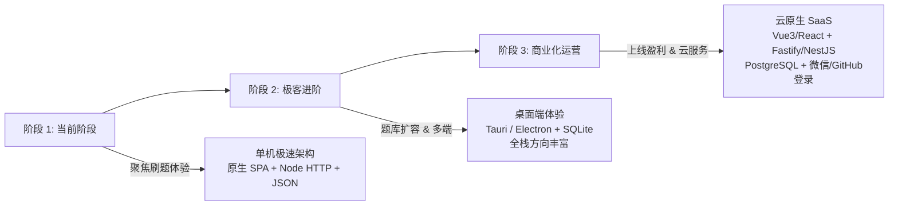

# SkillPulse · 智面星 —— 系统架构与技术演进评估报告

> **评估目标**：针对个人当前使用、未来多语言/多学科扩展、以及商业化上线运营三大阶段，深度评估当前技术选型与升级方案（Vue3 + Vite、后端独立拆分、企业级数据库等）的必要性与演进路线。

---

## 一、 当前架构现状分析 (Current State)

```
┌─────────────────────────────────────────────────────────────┐
│                   SkillPulse 2.0 (当前架构)                  │
├──────────────────────────────┬──────────────────────────────┤
│ 1. 前端层 (Frontend)         │ 原生现代化 SPA (HTML5/CSS3/JS)│
│                              │ - 零编译构建，双击即用        │
│                              │ - Linear / Raycast 暗色设计规范│
│                              │ - 内置 i18n、排除法过滤器、分页│
├──────────────────────────────┼──────────────────────────────┤
│ 2. 服务层 (Backend)          │ Node.js 原生轻量服务 (server.js)│
│                              │ - 纯原生内置模块，零 npm 依赖 │
│                              │ - 静态托管 + API 转发中继     │
├──────────────────────────────┼──────────────────────────────┤
│ 3. 存储层 (Database)         │ 本地文件持久化 (data/data.json)│
│                              │ - .tmp 原子重命名落盘，防崩溃 │
│                              │ - 兼具 localStorage 双向镜像  │
└──────────────────────────────┴──────────────────────────────┘
```

### 核心优势
1. **极速开箱即用（零依赖）**：无庞大的 `node_modules`（节省数以百兆的磁盘空间），双击 `start.bat` 秒启，任意装有 Node.js 的电脑拷过去就能跑。
2. **离线双轨可用**：即使断网或双击 HTML（`file://`），也能依赖内置题库和 localStorage 正常刷题。
3. **极佳的抗崩性与低心智负担**：没有 Webpack/Vite 插件版本冲突、没有 TypeScript 类型编译报错阻断、没有数据库服务死锁风险。

---

## 二、 专项深度评估 (Detailed Evaluation)

### 1. 前端是否需要重构成 Vue3 + Vite？

| 评估维度 | 当前原生单页 (Vanilla SPA) | Vue3 + Vite + Pinia + Tailwind | 评估结论 |
| :--- | :--- | :--- | :--- |
| **首屏加载与体积** | **极高**（< 150KB，0ms 打包） | 中等（数十个 chunk，需构建） | 当前原生优势显著 |
| **维护便利度** | 单文件集中，无需配环境 | 组件解耦、单文件组件（SFC）清晰 | 业务超 10 个复杂页面时 Vue3 占优 |
| **生态组件库** | 原生手写（已实现 Raycast 级高质感） | 现成组件多（Shadcn-vue、Element-Plus） | 当前已完成全套核心交互 |
| **团队协作** | 适合个人独立开发 | 适合多人协作、模块规范化 | 当前阶段更轻快 |

> **评估结论**：
> - **当前阶段（个人刷题为主）**：**暂无必要重构**。目前已将 i18n、排除法、多方向 Tracks、分页、快捷键交互全部原生结构化封装完毕，运行如丝般顺滑，重构反而会带来构建配置、依赖升级、包体积膨胀等维护成本。
> - **何时必须转 Vue3**：当项目需要引入**复杂富文本代码编辑器（Monaco/CodeMirror 实时在线运行调试代码）**、**画布拖拽（Canvas/白板绘图题）**或有**多人协同开发**时，才是迁移到 Vue3 + Vite 的最佳时机。

---

### 2. 后台是否需要单独拆分（如 NestJS / Express / Fastify）？

| 评估维度 | 当前 Node.js 原生 HTTP | 独立后端框架 (NestJS / Express) |
| :--- | :--- | :--- |
| **依赖成本** | 0 依赖，仅用 `http`、`fs`、`path` | 需安装框架核心包及数十个子依赖 |
| **业务承载** | 目前仅 3 个接口（`/api/data`、`/api/ai`、静态托管） | 支持 Controller / Service / Guard / Filter 严密分层 |
| **鉴权与安全** | 本地单机无需鉴权 | 方便接入 JWT、OAuth（GitHub/微信登录）、Rate Limit 防刷 |

> **评估结论**：
> - **当前阶段**：**保持现状**。当前服务仅承担本地原子文件写入与 AI 中继，Node.js 原生 200 行代码足够稳定高效。
> - **何时必须拆分**：当启动**商业化运营**（Requirement 7），需要真正接入微信/GitHub 登录鉴权、会员权限控制、支付 Webhook 回调、AI 请求频率限制时，建议单独抽离一个独立的后端服务（推荐选用轻量级的 **Fastify** 或规范严密的 **NestJS**）。

---

### 3. 数据库是否需要升级为更高级的（SQLite / PostgreSQL）？

| 数据库方案 | 适用场景 | 优点 | 缺点 |
| :--- | :--- | :--- | :--- |
| **当前：JSON 原子文件** | 个人本地应用 (< 5万题) | 无需安装 DB 服务，人机可读，Git 友好，换电脑即拷即走 | 不支持并发事务，不支持复杂连表 |
| **过渡首选：SQLite (better-sqlite3)** | 个人桌面端 / 单机部署 (< 100万题) | **单文件免配置**，支持 ACID 事务，支持 FTS5 全文秒级搜索 | 不适合多节点分布式集群 |
| **终极方案：PostgreSQL + Prisma** | 线上商业化运营多租户 SaaS | 支持高并发读写、行级安全（RLS）、JSONB 混合查询、云端托管 | 必须运维独立数据库实例或购买云 RDS |

> **评估结论**：
> - **当前阶段**：当前 `data.json` 完全胜任（目前数据量约为数百至数千道题，毫秒级读写）。
> - **升级路线建议**：
>   1. **下一步（若本地题库突破 1 万题）**：引入 **SQLite**。无需安装数据库服务，依然是单个文件，却能获得关系型查询与全文搜索能力。
>   2. **商业化上线**：直接拥抱 **PostgreSQL**（可直接配合 **Supabase** 免费托管，开箱自带用户鉴权、数据库与行级权限）。

---

## 三、 三阶段演进路线图 (Evolution Roadmap)



### 阶段 1：个人刷题利器（当前状态，最优解）
- **核心重点**：以最快速度刷题、背题、模拟考、排坑，无环境依赖，免去一切折腾。
- **技术栈**：极简 Node.js + 高质感原生 SPA + 本地原子 JSON 落盘。

### 阶段 2：全端跨平台桌面应用（中短期进阶）
- **触发条件**：想作为独立客户端（Windows / Mac）在桌面上离线使用，或题库数量极大。
- **推荐方案**：采用 **Tauri 2.0** 将当前代码打包成仅 10MB 的极速桌面 App，数据库换用内置 **SQLite**。

### 阶段 3：在线商业化 SaaS（线上运营）
- **触发条件**：购买独立域名，开放全网用户注册、购买会员、多端同步错题、天梯榜。
- **推荐方案**：
  - 前端：Vue3 + Vite + TailwindCSS + Pinia
  - 后端：Fastify / NestJS + TypeScript
  - 数据库与鉴权：PostgreSQL + Supabase（支持微信公众号扫码 / GitHub OAuth）
  - 部署：Vercel / 腾讯云轻量服务器 + CDN

---

## 四、 总结与建议行动指南

> **一句话建议**：**“先做对，再做大；先通关面试，再重构上云”**。
> 
> 目前项目已按照你的需求完成深度架构升级：
> 1. ✅ **练习组删除与 10 条/页分页**已全量实现；
> 2. ✅ **排除法选题机制**（支持自由增删排除词，在 AI 与本地题库严格生效）已就绪；
> 3. ✅ **中英双语国际化 (i18n)** 架构已全面铺设；
> 4. ✅ **多学科 (Java/Python/C++) 扩展插槽**与规范命名已写活；
> 5. ✅ **Linear / Raycast 级高颜值设计**与键盘快捷键已上线；
> 6. ✅ **注册登录机制与数据实体已预留**。
>
> **当前无需大动干戈重构为 Vue3 或拆分数据库，把重心 100% 放在刷前端面试题上即可！**
